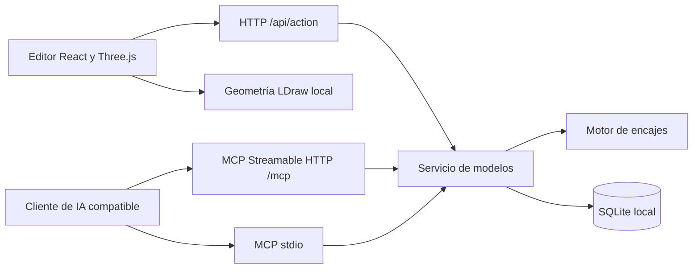

# Arquitectura de Brickforge

**BETA · 0.1.0-beta.1.** Brickforge separa el diseño elegido por una IA de las reglas de ensamblaje. La IA propone piezas y conexiones; el servidor calcula la colocación y valida el modelo completo antes de persistir cambios estructurales.

## Módulos

| Ruta | Responsabilidad |
| --- | --- |
| `components/studio.tsx` | Editor, catálogo, selección, previsualización y acciones |
| `components/brick-viewer.tsx` | Escena 3D y representación LDraw |
| `src/` | Entrada React y estilos del cliente |
| `lib/model.ts` | Esquema de piezas, validación básica, colores, inventario y exportación |
| `lib/assembly.ts` | Perfiles físicos, conectores, colisiones y cálculo de colocaciones |
| `lib/service.ts` | Operaciones compartidas y persistencia con control de revisión |
| `lib/mcp-tools.ts` | Esquemas y descripciones de las 15 herramientas MCP |
| `lib/geometry.ts` | Acceso y caché de geometrías comprimidas del navegador |
| `server/http.ts` | Archivos estáticos, API, sesiones y transporte MCP HTTP |
| `server/mcp.ts` | Adaptador del SDK MCP al servicio |
| `server/stdio.ts` | Transporte MCP stdio |
| `server/database.ts` | SQLite nativo de Node y esquema local |
| `server/backup.ts` | Exportación e importación offline de modelos |
| `public/catalog/` | Catálogo, geometrías empaquetadas y atribuciones LDraw |
| `scripts/` | Compilación y pruebas |

Vite genera el cliente en `dist/`. Esbuild compila las tres entradas Node en `dist-server/`, manteniendo las dependencias npm externas. No existe una dependencia de ejecución de Sites, ChatGPT ni Cloudflare.

## Modelo y persistencia

Un modelo tiene `id`, `name`, `revision`, `pieces` y `updatedAt`. Cada pieza tiene un ID único, referencia LDraw, código de color, posición, rotación, paso y grupo.

Las posiciones usan unidades LDraw: **20 unidades por tetón, 24 de alto por ladrillo y 8 por placa**. En el editor, X apunta a la derecha, Y hacia arriba y Z hacia delante. Las rotaciones son ángulos Euler XYZ en grados. La exportación adapta el eje Y y la matriz al convenio LDraw.

SQLite almacena los modelos en una tabla, con piezas serializadas en JSON. La instalación utiliza un propietario lógico `local`, compartido por el editor y ambos transportes MCP. El modo WAL y un tiempo de espera de 5 segundos permiten coordinar acceso local; el sistema no es una base distribuida ni ofrece separación entre usuarios.

Cada escritura comprueba `expectedRevision` y realiza una actualización condicionada por ID, propietario y revisión. Solo una escritura concurrente sobre la misma revisión puede ganar. El cliente debe volver a leer el modelo después de un conflicto.

## Motor de ensamblaje

El catálogo contiene 20.315 referencias para buscar y visualizar. **87 referencias tienen perfiles de ensamblaje explícitos**. La presencia de una malla LDraw no implica que exista un perfil de encaje.

Cada perfil define sólidos convexos y conectores tetón/hueco con identificadores estables, posición y normal locales. Al colocar una pieza, el motor transforma el perfil a coordenadas globales. Se contemplan 24 orientaciones ortogonales derivadas de giros de 90°.

`find_connections` combina conectores compatibles y orientaciones, calcula la transformación y comprueba candidatos con el validador. La búsqueda se pagina y limita a 128 comprobaciones geométricas por llamada. `connect_piece` recibe los identificadores de los conectores y una orientación, recalcula la posición y valida de nuevo sobre la revisión vigente.

La validación incluye:

- Perfiles y giros admitidos, y máximo de 40.000 puntos de conexión.
- Colisiones entre cuerpos mediante una fase de descarte por límites y pruebas entre sólidos convexos.
- Tetones que atraviesan cuerpos sin un hueco compatible, y colisiones entre tetones.
- Compatibilidad y ocupación de conectores.
- Penetración del suelo y un grafo de conexiones que exige que cada componente llegue a una pieza apoyada en el suelo.

Los arcos se componen de varios volúmenes para conservar la abertura. Algunas superficies curvas se aproximan de forma conservadora. No hay simulación de fuerzas, fricción, estabilidad ni articulaciones. El informe limita los detalles a 80 incidencias.

`place_on_ground` permite iniciar otro subconjunto en una posición libre calculada por el servidor. No exige que todos los subconjuntos estén unidos entre sí, pero cada uno debe tener apoyo en el suelo.

## Escrituras y modelos antiguos

Las altas, movimientos, cambios de pieza, eliminaciones, importaciones desde el editor y restauraciones con `replace_model` comparten la validación. Una edición estructural solo se guarda si el modelo resultante es válido. Los cambios exclusivamente cosméticos conservan modelos antiguos sin exigir reparar toda su geometría.

La herramienta offline de copias es una excepción deliberada para migración: valida la estructura básica de los datos y conserva geometría antigua. No está expuesta como herramienta MCP. Debe manejarla el administrador con copias de confianza.

## Red y autenticación

El servidor HTTP escucha por defecto en loopback. Una escucha remota exige clave y origen público. La API y MCP comparten autenticación por Bearer o sesión web; los recursos estáticos del editor y del catálogo son públicos dentro del endpoint permitido.

La sesión web utiliza cookie HttpOnly firmada, `SameSite=Strict` y caducidad de 12 horas. El servidor comprueba `Host`, `Origin` si existe y el indicador de petición entre sitios. stdio no utiliza HTTP ni la clave: su protección son los permisos del sistema operativo y el cliente que lo inicia.

## Pruebas y límites de garantía

`npm test` ejecuta pruebas del modelo, los pies del robot y el motor de ensamblaje, además de una integración con clientes del SDK MCP por HTTP y stdio. Utiliza bases temporales y comprueba persistencia, revisiones entre procesos, autenticación, rechazo de orígenes ajenos, aislamiento de archivos y copias/restauraciones.

Estas pruebas cubren los mecanismos implementados; no certifican la viabilidad física de toda construcción ni compatibilidad universal con cualquier cliente de IA. La imagen Docker está preparada, pero aún requiere verificación en ejecución.
