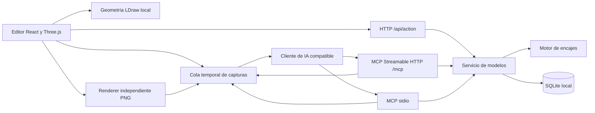

# Arquitectura de Brickforge

**BETA · 0.3.0-beta.12.** Brickforge separa el diseño elegido por una IA de las reglas de ensamblaje. La IA propone piezas y conexiones; el servidor calcula la colocación y valida el modelo completo antes de persistir cambios estructurales.

## Módulos

| Ruta | Responsabilidad |
| --- | --- |
| `components/studio.tsx` | Editor, catálogo, selección, previsualización y acciones |
| `components/brick-viewer.tsx` | Escena 3D y representación LDraw |
| `components/viewer-instances.ts` | Lotes gráficos de piezas, límites espaciales y selección de la pieza original |
| `components/model-capture.ts` y `components/capture-worker.tsx` | Render aislado del modelo solicitado y procesamiento de capturas |
| `src/` | Entrada React y estilos del cliente |
| `lib/model.ts` | Esquema de piezas, validación básica, colores, inventario y exportación |
| `lib/base-profiles.ts` | Familias físicas revisadas, sólidos y conectores |
| `lib/assembly.ts` | Resolución de perfiles, colisiones y cálculo de colocaciones |
| `lib/axial-fit.ts` | Validación de secciones axiales R4, contratos fijos y desplazamientos compatibles |
| `lib/axial-connections.ts` | Emparejamiento axial y reservas de intervalos sobre barras |
| `lib/assembly-variants.json` | Registro generado de decoraciones geométricamente verificadas |
| `lib/generated-assembly.json` y `lib/generated-profiles.ts` | Índice de perfiles generados, cobertura, motivos de exclusión y límites de ajuste |
| `lib/shadow-catalog.json` y `lib/collision-manifest.json` | Índices de metadatos de conexión y envolventes de colisión; no conceden soporte por sí solos |
| `lib/service.ts` | Operaciones compartidas y persistencia con control de revisión |
| `lib/mcp-tools.ts` | Esquemas y descripciones de las 16 herramientas MCP |
| `lib/geometry.ts` | Acceso y caché de geometrías comprimidas del navegador |
| `server/http.ts` | Archivos estáticos, API, sesiones y transporte MCP HTTP |
| `server/mcp.ts` | Adaptador del SDK MCP al servicio |
| `lib/capture.ts` y `server/capture.ts` | Contrato visual y cola temporal compartida entre procesos |
| `server/stdio.ts` | Transporte MCP stdio |
| `server/database.ts` | SQLite nativo de Node y esquema local |
| `server/backup.ts` | Exportación e importación offline de modelos |
| `server/profile-assets.ts` | Carga diferida, integridad y caché acotada de perfiles generados durante cada operación |
| `public/catalog/` | Catálogo, geometrías empaquetadas y atribuciones LDraw |
| `vendor/ldcad-shadow/` | Instantánea local de datos de conexión LDCad y su licencia |
| `scripts/` | Compilación y pruebas |
| `scripts/lib/axial-shaft.mjs`, `scripts/lib/axial-envelope.mjs` | Prueba de barras completas y derivación de canales pasantes sin retirar material de origen |
| `scripts/lib/generated-axial-profile.mjs` | Adaptación de esas pruebas a perfiles axiales versión 2 |

Vite genera el cliente en `dist/`. Esbuild compila las tres entradas Node en `dist-server/`, manteniendo las dependencias npm externas. No existe una dependencia de ejecución de Sites, ChatGPT ni Cloudflare.

## Visor interactivo

Desde la beta.12, el visor agrupa las superficies y las líneas de piezas opacas por referencia y color, en lotes de hasta 512 piezas. Comparte su geometría en la GPU y envía las transformaciones como instancias. La conversión del eje Y de LDraw se aplica a la plantilla, incluidos normales, orientación de triángulos y puntos de control de las líneas condicionales. Las piezas transparentes se mantienen separadas para conservar el orden de dibujo por profundidad.

El visor solo dibuja cuando cambia la escena, la selección, el tamaño de ventana o la cámara, incluidos los últimos movimientos amortiguados de OrbitControls. Las sombras se actualizan al cambiar las piezas o el paso visible; girar la cámara conserva el mapa de sombras. La selección comprueba primero los límites espaciales y después la geometría de la pieza, devolviendo su ID original. Estos lotes solo afectan a la representación: el servidor conserva las piezas individuales y todas las reglas de encaje.

`scripts/viewer-performance.mjs` monta este componente en un perfil Electron temporal y mide la carga, el tiempo de la llamada de render y las llamadas de dibujo al orbitar. La ventana oculta puede limitar la frecuencia de los callbacks: su cadencia no equivale a FPS interactivos, y el tiempo de la llamada JavaScript no es una medición del temporizador de la GPU. El ensayo también comprueba selección, pasos, cambios y borrados. Sus entradas y resultados quedan fuera de la aplicación distribuida. La captura solicitada por MCP mantiene su renderer independiente.

## Modelo y persistencia

Un modelo tiene `id`, `name`, `revision`, `pieces` y `updatedAt`. Cada pieza tiene un ID único, referencia LDraw, código de color, posición, rotación, paso y grupo.

Las posiciones usan unidades LDraw: **20 unidades por tetón, 24 de alto por ladrillo y 8 por placa**. En el editor, X apunta a la derecha, Y hacia arriba y Z hacia delante. Las rotaciones son ángulos Euler XYZ en grados. La exportación adapta el eje Y y la matriz al convenio LDraw.

SQLite almacena los modelos en una tabla, con piezas serializadas en JSON. La instalación utiliza un propietario lógico `local`, compartido por el editor y ambos transportes MCP. El modo WAL y un tiempo de espera de 5 segundos permiten coordinar acceso local; el sistema no es una base distribuida ni ofrece separación entre usuarios.

Cada escritura comprueba `expectedRevision` y realiza una actualización condicionada por ID, propietario y revisión. Solo una escritura concurrente sobre la misma revisión puede ganar. El cliente debe volver a leer el modelo después de un conflicto.

## Imágenes MCP

`capture_model` lee una instantánea autorizada del modelo y crea una solicitud en una base SQLite temporal separada de la principal. HTTP y stdio utilizan la misma cola cuando apuntan a la misma base de modelos. El frontend autenticado reclama un trabajo mediante una concesión exclusiva, renderiza todas sus geometrías locales en un canvas independiente y entrega un PNG. El adaptador MCP devuelve un bloque `image` estándar junto a la revisión y las opciones de captura.

Los endpoints de captura comparten las restricciones Host/Origin y la autenticación del editor. La entrega valida la concesión, la caducidad, el formato y las dimensiones del PNG. La cola tiene límites de concurrencia, tamaño y tiempo; las respuestas no contienen rutas de archivos ni permiten pedir URLs externas. Se consumen y eliminan los resultados, sin añadirlos a los modelos o sus copias JSON. SQLite/WAL y las copias del sistema pueden conservar bytes temporales.

El renderer no cambia la escena que está editando el usuario ni captura la pantalla. Necesita un frontend conectado; no instala un navegador headless en el servidor. Electron mantiene activo el procesamiento con la ventana minimizada. Si no hay renderer, caduca la petición con un error explícito. El cliente MCP decide si entrega la imagen a un modelo con visión.

## Motor de ensamblaje

El catálogo contiene **20.315 referencias** para buscar y visualizar y **6.896 referencias construibles**, repartidas en tres capas sin duplicados:

| Capa | Referencias | Criterio |
| --- | --- | --- |
| Perfiles manuales | 128 | Sólidos y conectores revisados por familia física |
| Variantes decoradas verificadas | 1.756 | Equivalencia geométrica probada con un perfil base |
| Perfiles generados | 5.012 | Metadatos LDCad compatibles, geometría de colisión y uniones estándar, axiales, de pin, de cuello o de cintura verificadas |

`catalog_info.connectionCoverage` separa estos grupos. `catalog_info.catalogCoverage` también expone el estado de las fuentes: 15.622 referencias tienen metadatos de conexión, 14.333 los tienen completamente interpretados y 12.446 tienen una envolvente compilada. Estos registros describen datos disponibles; **no son cifras de piezas construibles**. La presencia de una malla, metadatos o una envolvente no concede un perfil válido. Consulta [cobertura y generación](CATALOG.md).

Las variantes heredan un único perfil base después de demostrar que mantienen su núcleo estructural y que toda geometría adicional permanece en las superficies revisadas. El compilador conserva una huella de las geometrías transitivas y del perfil. No se admite una pieza por parecido de nombre o tamaño.

Los perfiles generados cruzan la instantánea de conexiones LDCad con envolventes obtenidas de las caras LDraw y comprobaciones de sus superficies. Exponen conectores estándar exteriores, un acceso estándar en concavidades o una unión R4, A6, de pin, de cuello o de cintura que el generador puede verificar; metadatos parciales, geometrías no admitidas o uniones no verificadas dejan un motivo de exclusión. El cuerpo convexo es conservador: no representa como utilizables todas las cavidades o concavidades reales. Los 5.012 perfiles comparten 4.150 archivos de geometría únicos por contenido.

De esas referencias, 3.261 utilizan perfiles estándar exteriores, 385 perfiles de acceso estándar, 17 perfiles axiales R4 y 199 perfiles A6; se añaden 297 referencias cuya familia principal es el pin Technic, 757 de cuello y 96 de cintura. En el caso estándar, si los obstáculos independientes exceden 128, se omiten únicamente los sólidos que ya estén completamente contenidos en el cuerpo del motor, sin tolerancia adicional ni retirada de volumen. Esto recupera referencias grandes sin modificar los perfiles ya admitidos.

La comprobación del receptor requiere un volumen de inserción libre y continuidad de material cercano entre 0,5 y 3,5 unidades LDraw de profundidad. Para las conexiones nominales R6/S6 se admite una **banda radial de 0,25 LDU** para esa presencia de material, debido a la representación simplificada de LDraw. No acredita contacto físico exacto, fuerza de sujeción ni tolerancias de fabricación. La tolerancia de penetración del validador de colisiones es **0,01 LDU** y es independiente de esa banda. Estos límites se exponen en `catalog_info.generatedFitLimits` y en `get_part.connectivity.fitLimits` para los perfiles generados, con `physicalContactCertified: false`.

La familia axial usa perfiles versión 2 con origen `ldraw-axial-envelope-v1`. El compilador comprueba una barra R4 completa o un canal pasante, deriva su sección de las caras reales y resta únicamente ese vacío de la envolvente conservando el material en varios sólidos convexos. La sección queda en orden antihorario con hasta 64 vértices y se transmite íntegra al comparador; si no cabe en el límite, el perfil se rechaza. La barra debe caber en esa sección con el umbral de ajuste existente de 0,01 LDU, y los cuerpos completos también deben superar SAT. Los límites se exponen en `catalog_info.generatedAxialFitLimits` y en `get_part.connectivity.fitLimits`.

El contrato `r4-through-sliding-v2` exige ejes coincidentes con precisión de `1e-8` LDU y contiene toda la longitud del receptor dentro de la barra. Ambos conectores deben ser v2 y al menos uno declarar `slide: true` para permitir desplazamiento. Cada receptor reserva su intervalo en el eje firmado de la barra; varios receptores solo pueden compartirla con intervalos sin solapamiento. Una pareja fija ocupa la barra de forma exclusiva. El contrato `r4-through-centered-fixed-v1`, también mezclado con v2, conserva centros coincidentes y un único compañero. No hay giro continuo.

`lib/axial-connections.ts` localiza parejas mediante una rejilla radial y un barrido por intervalos antes de comparar secciones. Ordena los extremos de forma determinista y calcula ocupaciones en el marco de la barra, incluso cuando la normal del receptor está invertida. Un exceso de posibles parejas produce un error de complejidad; nunca se guarda un modelo omitiendo esas comprobaciones.

Cada perfil define sólidos convexos y conectores con identificadores estables, posición y normal locales. Los conectores `bar`/`bar-socket` añaden longitud, marco radial y sección. Al colocar una pieza, el motor transforma el perfil a coordenadas globales. Se contemplan 24 orientaciones ortogonales derivadas de giros de 90°.

`find_connections` combina conectores compatibles y orientaciones, calcula la transformación y comprueba candidatos con el validador. Para las uniones axiales muestrea desplazamientos cada 4 LDU y límites de tramos libres, calculados sin materializar todos los puntos de una barra larga. La búsqueda se pagina y limita a 128 candidatos por llamada, o uno para modelos de más de 5.000 piezas; puede devolver una página vacía con `nextOffset` pendiente. Cada candidato conserva la validación completa. Agotar la búsqueda no prueba la ausencia de un desplazamiento continuo válido.

`connect_piece` recibe los identificadores de los conectores, una orientación y, opcionalmente, `axialOffset`. Este número finito desplaza el punto del nuevo conector sobre la normal global del anclaje. El motor recalcula la posición y valida de nuevo compatibilidad, contención, reservas, colisiones y conexión al suelo sobre la revisión vigente. `get_connections` expone las reservas y si la barra es compartible; un indicador `occupied: false` no garantiza espacio para cualquier receptor.

La validación incluye:

- Hasta 15.000 piezas por modelo. Los límites compartidos están en `lib/limits.ts`; el guardado mide 16 MiB de JSON normalizado en UTF-8 y la importación y las peticiones de modelos admiten 20 MiB.
- Perfiles y giros admitidos, y máximo de 300.000 puntos de conexión.
- Colisiones entre cuerpos mediante una fase de descarte por límites y pruebas entre sólidos convexos.
- Tetones que atraviesan cuerpos sin un hueco compatible, y colisiones entre tetones.
- Compatibilidad y ocupación de conectores, incluidas la exclusividad de los receptores axiales y las reservas de tramos sobre las barras.
- Penetración del suelo y un grafo de conexiones que exige que cada componente llegue a una pieza apoyada en el suelo.

Los arcos con perfil manual se componen de varios volúmenes para conservar la abertura; los generados pueden mantenerla rellena de forma conservadora. Algunas superficies curvas también se aproximan. No hay simulación de fuerzas, fricción, estabilidad ni movimiento de articulaciones. El informe limita los detalles a 80 incidencias.

`place_on_ground` permite iniciar otro subconjunto en una posición libre calculada por el servidor. No exige que todos los subconjuntos estén unidos entre sí, pero cada uno debe tener apoyo en el suelo.

La familia A6 usa perfiles versión 3 y origen `ldraw-keyed-axial-envelope-v1`. `lib/keyed-axial-fit.ts` valida dos componentes convexos de sección, el marco ortogonal y la contención en el intervalo útil del eje. `lib/mechanical-fit.ts` despacha por familia sin permitir cruces R4/A6. El colector comparte la reserva de intervalos; los campos históricos `barPieceId` y `barConnectorId` también identifican ejes A6. La generación combina `keyed-axial-shaft.mjs`, `keyed-axial-channel.mjs` y `generated-keyed-axial-profile.mjs`; el cargador valida el contrato antes de habilitar los conectores. Consulta las pruebas y limitaciones en [Catálogo](CATALOG.md#ejes-technic-a6).

Los perfiles versión 4 (`ldraw-standard-access-envelope-v1`) se generan con `standard-access.mjs` y `generated-access-profile.mjs`. El primero prueba el vacío de una columna exterior frente a todas las caras de origen; el segundo exige un conector estándar certificado, conserva los tetones inactivos y vincula ambas pruebas a la misma huella de geometría. El cargador solo admite conectores estándar en estos perfiles. No cambia el contrato de colocación ni el detector SAT.

## Generación y carga del catálogo

El catálogo es local. `npm run catalog:generate` ejecuta, en orden, la prueba de variantes, la resolución de metadatos LDCad, la compilación de envolventes y la generación de perfiles mecánicos. Produce registros y archivos distribuibles; no se ejecuta para conectar cada pieza ni necesita descargar un catálogo durante el uso normal. `npm run catalog:check` comprueba las fuentes, huellas y atribuciones. `npm run build` ejecuta esa comprobación y falla si el catálogo está desactualizado.

El servidor consulta un índice compacto y carga los archivos de `dist/catalog/assembly` solo al necesitar sus perfiles. `server/profile-assets.ts` comprueba tamaño, SHA-256, límites de descompresión y estructura antes de utilizarlos. La caché aplica un presupuesto de **128 MiB** con un cargo de cuatro veces el JSON descomprimido para estimar la sobrecarga de objetos; es un presupuesto de caché, no un máximo de memoria total del proceso.

Cada operación mantiene fijados los perfiles que utiliza, incluso durante esperas asíncronas, y los libera al terminar. Las entradas sin uso pueden expulsarse; si el conjunto solicitado no cabe en el presupuesto, la operación falla en lugar de omitir la validación. Un archivo ausente, corrupto o aún no preparado tampoco permite eludir el motor.

## Escrituras y modelos antiguos

Las altas, movimientos, cambios de pieza, eliminaciones, importaciones desde el editor y restauraciones con `replace_model` comparten la validación. Una edición estructural solo se guarda si el modelo resultante es válido. Los cambios exclusivamente cosméticos conservan modelos antiguos sin exigir reparar toda su geometría.

Los modelos guardan referencias y colocaciones, no una copia del contrato geométrico de cada perfil. Por tanto, se validan con los perfiles de la versión instalada. La compatibilidad del motor con el contrato v1 no significa que un modelo conserve automáticamente su antiguo perfil tras actualizar el catálogo.

La herramienta offline de copias es una excepción deliberada para migración: valida la estructura básica de los datos y conserva geometría antigua. No está expuesta como herramienta MCP. Debe manejarla el administrador con copias de confianza.

## Red y autenticación

El servidor HTTP escucha por defecto en loopback. Una escucha remota exige clave y origen público. La API y MCP comparten autenticación por Bearer o sesión web; los recursos estáticos del editor y del catálogo son públicos dentro del endpoint permitido.

La sesión web utiliza cookie HttpOnly firmada, `SameSite=Strict` y caducidad de 12 horas. El servidor comprueba `Host`, `Origin` si existe y el indicador de petición entre sitios. stdio no utiliza HTTP ni la clave: su protección son los permisos del sistema operativo y el cliente que lo inicia.

## Pruebas y límites de garantía

`npm test` ejecuta pruebas del modelo, los pies del robot y el motor de ensamblaje, además de una integración con clientes del SDK MCP por HTTP y stdio. Utiliza bases temporales y comprueba persistencia, revisiones entre procesos, autenticación, rechazo de orígenes ajenos, aislamiento de archivos y copias/restauraciones.

`npm run test:catalog` agrupa pruebas de variantes, resolución LDCad, envolventes, generación de perfiles y carga de perfiles en ejecución. Incluye barras y canales axiales, conservación del material, secciones, colocación y una integración de cinco referencias reales con un manifiesto temporal aislado. Al modificar una fuente o una regla de generación, regenera el catálogo, revisa el resultado y ejecuta `catalog:check`, `test:catalog`, compilación e integración. La [guía de contribución](../CONTRIBUTING.md) detalla ese flujo.

Estas pruebas cubren los mecanismos implementados; no certifican la viabilidad física de toda construcción ni compatibilidad universal con cualquier cliente de IA. La imagen Docker está preparada, pero aún requiere verificación en ejecución.

Los perfiles v5 (`ldraw-technic-pin-envelope-v1`) amplían perfiles anteriores o habilitan referencias nuevas mediante `technic-pin-channel.mjs`, `technic-pin-shaft.mjs` y `generated-technic-pin-profile.mjs`. El contrato fijo está en `technic-pin-fit.ts`; cada extremo o agujero admite un compañero. El cargador valida todos los conectores de un perfil mixto y exige al menos un puerto de pin válido. No cambia el detector SAT ni el control de revisión de las escrituras.

La beta.6 añadió **297 referencias construibles** mediante agujeros Technic y amplió **72 referencias ya admitidas**, conservando sus IDs de conexión anteriores. En total, **369 referencias** ofrecen el contrato de pin fijo. Esta cifra se solapa con las familias anteriores y no se suma de nuevo al total.

Los perfiles v6 (`ldraw-minifig-neck-envelope-v1`) se generan con `minifig-neck.mjs` y `generated-minifig-neck-profile.mjs`. `minifig-neck-fit.ts` define el asiento fijo. El cargador exige al menos un conector de cuello válido y verifica también los puertos heredados. Se conservan la validación SAT de cuerpos completos, los límites de complejidad, las revisiones y la atomicidad de escrituras.

La beta.7 añadió **757 referencias construibles** y amplió **415 perfiles anteriores** mediante encajes de cuello. **1.172 referencias** ofrecen esta capacidad; se solapa con las familias anteriores y no se suma de nuevo al total.

Los perfiles v7 (`ldraw-minifig-hips-envelope-v1`) añaden el par de cintura certificado por `minifig-hips.mjs` y conservan los conectores heredados mediante `generated-minifig-hips-profile.mjs`. `minifig-hips-fit.ts` exige normales opuestas y direcciones de bisel iguales. El cargador comprueba el contrato de cada puerto y la separación, orientación y rol del par completo. La transformación de piezas rota también `heading`; la caché de búsqueda distingue esa dirección. Se mantienen SAT, los límites y la atomicidad del servidor.

La beta.8 añade **96 referencias construibles** y amplía **775 perfiles anteriores** mediante encajes de cintura. **871 referencias** ofrecen esta capacidad; se solapa con las familias anteriores y no se suma de nuevo al total.

La beta.9 corrige la búsqueda espacial de conectores no axiales en los límites entre celdas. El índice considera las celdas vecinas y el comparador de cada contrato decide si existe unión; no se amplían las tolerancias para aceptar una colocación. Las pruebas incluyen coordenadas decimales, orientaciones globales, límites de distancia y ocupación.
